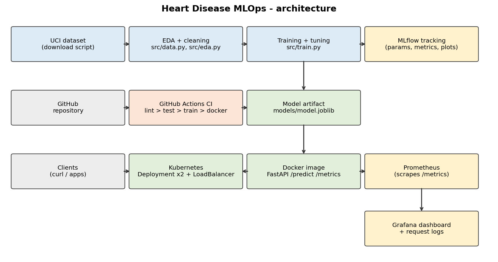

# Heart Disease Risk – End-to-End MLOps

Predicts the presence of heart disease from the UCI Heart Disease (Cleveland) data and serves
the model as a containerised, monitored FastAPI service deployed on Kubernetes.



## Repository layout

| Path | Purpose |
|---|---|
| `src/data.py` | Download script + cleaning (`python -m src.data`) |
| `src/eda.py`, `notebooks/01_eda.ipynb` | EDA figures (histograms, heatmap, class balance …) → `screenshots/eda/` |
| `src/features.py` | Preprocessing transformers (impute, scale, one-hot) |
| `src/train.py`, `notebooks/02_training_and_inference.ipynb` | Tuning, cross-validation, MLflow tracking, model selection |
| `src/predict.py` | Offline inference CLI (single JSON or batch CSV) |
| `app/main.py` | FastAPI service: `/predict`, `/health`, `/metrics` + request logging |
| `tests/` | Pytest unit tests (data, features, model, training, inference, API, EDA) |
| `.github/workflows/ci.yml` | Lint → test → EDA → train → inference → Docker build + smoke test |
| `Dockerfile`, `requirements-serve.txt` | Slim serving image |
| `k8s/` | Deployment (2 replicas, probes, resources) + LoadBalancer Service |
| `monitoring/` | Prometheus + Grafana (provisioned datasource and dashboard) via docker compose |
| `report/report.md` | Written report |
| `screenshots/` | Evidence for the report |

## 1. Setup (Python 3.11)

```bash
python3.11 -m venv .venv && source .venv/bin/activate
pip install -r requirements.txt
```

## 2. Data, EDA, training, tracking

```bash
python -m src.data      # download UCI data -> data/raw, write data/heart_clean.csv
python -m src.eda       # figures -> screenshots/eda/
python -m src.train     # grid-search + CV for 2 models, logs to MLflow, saves models/model.joblib
mlflow ui --backend-store-uri sqlite:///mlflow.db     # http://127.0.0.1:5000
python -m src.predict --json '{"age":63,"sex":1,"cp":1,"trestbps":145,"chol":233,"fbs":1,"restecg":2,"thalach":150,"exang":0,"oldpeak":2.3,"slope":3,"ca":0,"thal":6}'
```

## 3. Quality checks

```bash
flake8 src app tests docs
pytest -v
```

CI runs the same steps on every push/PR, fails on any lint/test/training error, and uploads
models, MLflow data, EDA figures and the pytest report as workflow artifacts.

## 4. Docker

```bash
docker build -t heart-api:1.0 .
docker run -d -p 8000:8000 --name heart-api heart-api:1.0
curl localhost:8000/health
curl -X POST localhost:8000/predict -H "Content-Type: application/json" \
  -d '{"age":63,"sex":1,"cp":1,"trestbps":145,"chol":233,"fbs":1,"restecg":2,"thalach":150,"exang":0,"oldpeak":2.3,"slope":3,"ca":0,"thal":6}'
```

Response:
```json
{"prediction": 0, "label": "no heart disease", "confidence": 0.8345, "probability_disease": 0.1655}
```
(`ca` and `thal` are optional – missing values are imputed by the pipeline.)

## 5. Kubernetes (Docker Desktop, Kubernetes enabled)

```bash
kubectl config use-context docker-desktop
kubectl apply -f k8s/
kubectl get pods,svc          # LoadBalancer exposes the API on http://localhost
curl localhost/health
```

For Minikube: `minikube image load heart-api:1.0` and `minikube tunnel`.

## 6. Monitoring

```bash
cd monitoring && docker compose up --build -d
```

* API: <http://localhost:8000> (send some `/predict` requests)
* Prometheus: <http://localhost:9090> (Status → Targets)
* Grafana: <http://localhost:3000> (admin/admin) → dashboard **Heart Disease API**
  (request rate, status codes, p95 latency, predictions per class, error ratio, uptime)
* Request logs: `docker compose logs -f api`

Shortcuts for all of the above are in the `Makefile` (`make train`, `make test`, `make docker-run` …).
