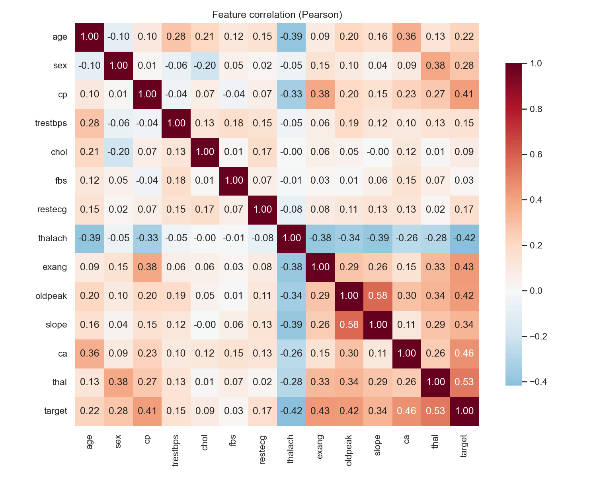
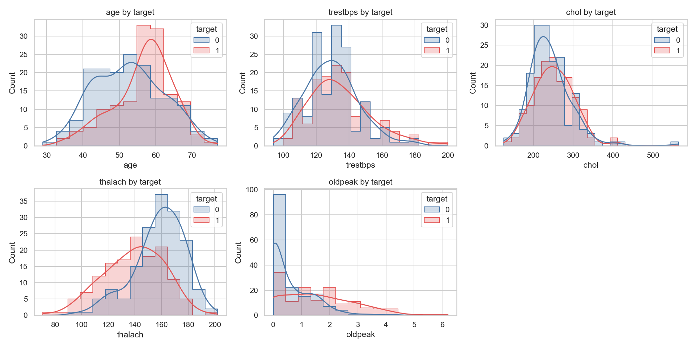
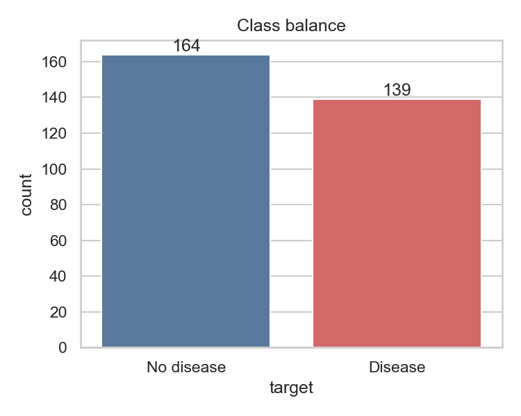

# Heart Disease Risk Prediction – MLOps Assignment 1 Report

**Course:** MLOps (AIMLCZG523) **Repository:** https://github.com/JohanVar05893/heart-disease-monitor-mlops

> Screenshots referenced below must be captured by running each stage and saved in
> `screenshots/` under the file names shown. Everything else is generated from the repo.

## 1. Problem and solution overview
Binary classifier predicting presence of heart disease from 13 clinical attributes
(UCI Cleveland data, 303 patients), delivered as a reproducible pipeline: tracked experiments →
tested and linted code → Docker image → Kubernetes deployment → Prometheus/Grafana monitoring.


## 2. Setup and installation
Python 3.11, Docker Desktop (with Kubernetes), Git. Then:

```bash
python3.11 -m venv .venv && source .venv/bin/activate
pip install -r requirements.txt
python -m src.data && python -m src.train && pytest
```
Full instructions: `README.md`.

## 3. Data acquisition and EDA
* `src/data.py` downloads `processed.cleveland.data` from the UCI repository and writes
  `data/heart_clean.csv`.
* Cleaning: `?` → NaN (affects `ca`, `thal`), duplicates dropped, target binarised
  (0 = healthy, 1–4 = disease).
* Missing values are imputed **inside the model pipeline** (median / most-frequent) so statistics
  come from training folds only – no leakage.

| Figure | File |
|---|---|
| Class balance | `screenshots/eda/class_balance.png` |
| Histograms by target | `screenshots/eda/histograms.png` |
| Box plots | `screenshots/eda/boxplots.png` |
| Categorical vs target | `screenshots/eda/categorical_vs_target.png` |
| Correlation heatmap | `screenshots/eda/correlation_heatmap.png` |
| Missing values | `screenshots/eda/missing_values.png` |





Key findings: classes are near-balanced; `thalach` is negatively and `thal`, `ca`, `exang`,
`oldpeak`, `cp` positively correlated with disease; predictor-to-predictor correlations are
moderate.

## 4. Feature engineering and modelling
* Numeric (`age, trestbps, chol, thalach, oldpeak`): median imputation + standardisation.
* Categorical (`sex, cp, fbs, restecg, exang, slope, ca, thal`): most-frequent imputation +
  one-hot encoding (`handle_unknown="ignore"`).
* One scikit-learn `Pipeline` (preprocessor + classifier) is the unit that is tuned, saved and served.
* 80/20 stratified hold-out (seed 42); 5-fold stratified CV and `GridSearchCV` (ROC-AUC) on the
  training portion only.

| Model | Grid |
|---|---|
| Logistic Regression | `C ∈ {0.01, 0.1, 1, 10}` |
| Random Forest | `n_estimators ∈ {100, 300}`, `max_depth ∈ {3, 5, None}`, `min_samples_leaf ∈ {1, 3}` |

### Results

| Model | Best params | CV acc | CV prec | CV recall | CV ROC-AUC | Test acc | Test prec | Test recall | Test ROC-AUC |
|---|---|---|---|---|---|---|---|---|---|
| Logistic Regression | C=1 | 0.847 | 0.877 | 0.783 | 0.902 | 0.885 | 0.839 | 0.929 | 0.966 |
| Random Forest | 100 trees, depth 5, leaf 3 | 0.806 | 0.811 | 0.764 | 0.902 | 0.869 | 0.833 | 0.893 | 0.948 |

**Selection:** the model with the highest cross-validated ROC-AUC is promoted. Both models tie to three
decimals on CV ROC-AUC (0.902); Logistic Regression is selected because it is also better on CV accuracy,
precision and recall, is simpler, faster to serve and easier to interpret. The hold-out set is used only
for the final report, not for selection.

Limitation: 303 samples – hold-out metrics have wide confidence intervals; treat them as indicative.

## 5. Experiment tracking (MLflow)
Each model type is one MLflow run in experiment `heart-disease` (SQLite backend `mlflow.db`).
Logged: parameters (model type, best hyper-parameters), CV and test metrics (mean and std),
ROC curve and confusion-matrix plots, and the fitted pipeline as a model artifact.

*Screenshots:* `screenshots/mlflow_runs.png`, `screenshots/mlflow_compare.png`, `screenshots/mlflow_run_detail.png`

## 6. Packaging and reproducibility
* `models/model.joblib` – full preprocessing + model pipeline; `models/metrics.json` – selected-model metrics.
* Pinned `requirements.txt` (development) and `requirements-serve.txt` (serving image).
* Fixed random seeds; CI retrains from the committed cleaned dataset on every run.
* `src/predict.py` reproduces predictions offline from the saved pipeline.

## 7. CI/CD (GitHub Actions)
Workflow `.github/workflows/ci.yml`: **flake8 → pytest (JUnit report) → EDA → training →
inference smoke test → artifact upload**, then a second job builds the Docker image and smoke-tests
`/health` and `/predict`. Any failure fails the workflow and prints the logs. Unit tests cover data
cleaning, preprocessing, model training and selection, inference CLI, EDA outputs and the API
(including input validation).

*Screenshots:* `screenshots/ci_success.png`, `screenshots/ci_artifacts.png`, `screenshots/ci_failure.png`

## 8. Containerisation
`Dockerfile` (python:3.11-slim, serving dependencies only, health check) runs
`uvicorn app.main:app`. Endpoints: `POST /predict` (JSON in → prediction, label, confidence,
probability), `GET /health`, `GET /metrics` (Prometheus).

*Screenshots:* `screenshots/docker_build.png`, `screenshots/docker_predict.png`

## 9. Kubernetes deployment
`k8s/deployment.yaml` (2 replicas, readiness/liveness probes, resource requests/limits) and
`k8s/service.yaml` (LoadBalancer, port 80 → 8000), deployed on Docker Desktop Kubernetes.

*Screenshots:* `screenshots/k8s_pods_svc.png`, `screenshots/k8s_predict.png`

## 10. Monitoring and logging
* Every request is logged (method, path, status, latency); every prediction logs the input and output.
* Prometheus scrapes `/metrics` (`api_requests_total`, `api_request_latency_seconds`,
  `api_predictions_total`).
* Grafana is provisioned automatically with a **Heart Disease API** dashboard: request rate, status codes,
  p95 latency, predictions per class, error ratio, API uptime.

*Screenshots:* `screenshots/prometheus_targets.png`, `screenshots/grafana_dashboard.png`, `screenshots/api_logs.png`

## 11. Conclusions and future work
The pipeline is reproducible end to end and automated by CI. Next steps: model registry with staged
promotion, data/prediction drift monitoring, Helm packaging, automated deploy from CI, and a larger
multi-site dataset (Cleveland only here).
